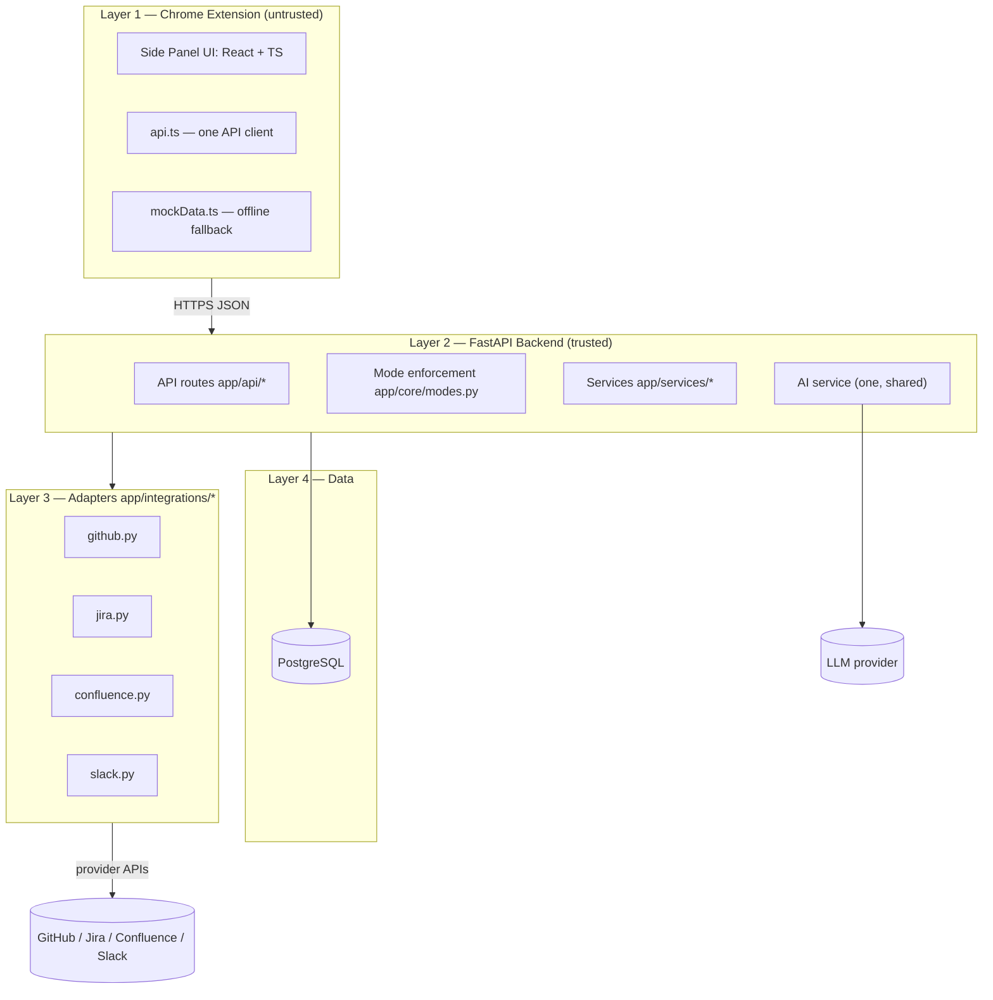
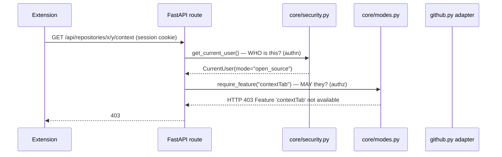
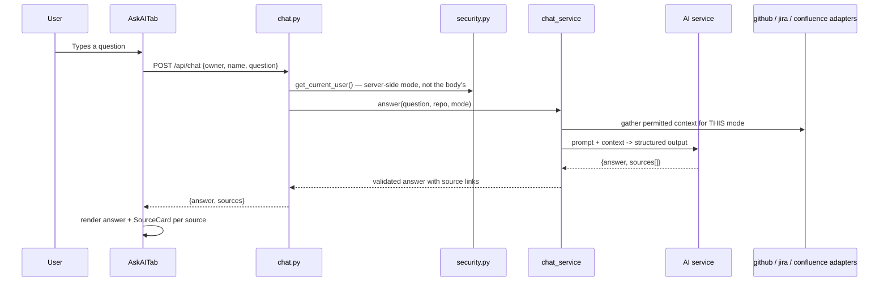

# DevMinds Architecture

This document explains how the pieces fit together. For endpoint-level detail
see [API_CONTRACT.md](API_CONTRACT.md).

## The golden rule

> **The backend finds and verifies facts. The AI explains them in simple words.
> The extension only displays them.**

Consequences:

- No secret keys ever go inside the extension. The extension is untrusted.
- Anything that costs trust (reading a private repo, calling Jira, calling an
  LLM) happens in the backend.
- The extension can be rebuilt from the API contract alone.

## Layers



| Layer | Responsibility | Lives in |
|---|---|---|
| Extension | Display, layout, mode-aware tab visibility | `extension/` |
| Backend routes | Validate, enforce mode, shape responses | `backend/app/api/` |
| Services | One analyzer, one architecture service, one context service, one chat service | `backend/app/services/` |
| Adapters | One adapter per provider, all behind `base.py` | `backend/app/integrations/` |
| Data | Users, saved links, analysis cache | `backend/app/database/` |

## One of each

To avoid four people building four of the same thing:

- **One repository analyzer** — `services/repository_analyzer.py` produces the
  single `ArchitectureBundle` for both modes.
- **One architecture schema** — `schemas/architecture.py`, mirrored by
  `extension/src/types/architecture.ts`.
- **One AI service** — every LLM call goes through it, with structured-output
  validation.
- **One set of reusable UI components** — `SourceCard.tsx` renders a GitHub
  file, a contribution resource, a Jira issue or a Confluence page with the
  same `title / description / sourceType / url` props.
- **One capabilities config** — `core/modes.py`. The extension reads it from
  `GET /api/me/mode`; it never invents features.
- **One adapter interface** — `integrations/base.py`. Every provider implements
  `check_connection()` plus `fetch`/`send`, returns clean data with source
  links, and handles errors and rate limits uniformly.

## Authentication vs authorization

Two different questions, two different mechanisms:



- **Authentication** (`core/security.py`): proves *who* you are via the GitHub
  OAuth session. Returns the current user, including their server-side mode.
- **Authorization** (`core/modes.py`): checks *what that user's mode allows*
  using `require_feature("...")` on the route.

**Never trust a mode value sent by the frontend.** The mode used for
authorization always comes from the server-side session, via the stubbed
current-user function (real session lookup is a TODO). The extension's mode
switcher only changes what is *shown*; the server re-checks every gated call.

## Mode switching rules

1. `PUT /api/me/mode` sets the user's mode server-side and returns the new
   feature list.
2. The extension re-renders tabs from that feature list.
3. Every gated endpoint still calls `require_feature(...)` — switching mode in
   the UI cannot unlock a company-only endpoint.
4. Company-only endpoints return `403` when the server-side mode lacks the
   feature.

## Analyze data flow

```mermaid
sequenceDiagram
    participant U as User (on a github.com page)
    participant Ext as Extension
    participant API as repositories.py
    participant An as repository_analyzer
    participant GH as github.py
    participant DB as PostgreSQL

    U->>Ext: Opens side panel on a repo page
    Ext->>Ext: repoDetector.ts parses owner/repo from tab URL
    Ext->>API: POST /api/repositories/analyze {owner, name, branch}
    API->>API: require_feature("privateRepos") if repo is private
    API->>An: analyze(owner, name, branch, mode)
    An->>GH: fetch metadata, tree, key files (rate-limit aware)
    GH-->>An: raw facts + source URLs
    An->>An: build ArchitectureBundle (facts only)
    An-->>API: ArchitectureBundle
    API-->>Ext: 202 job / or 200 bundle from cache
    Ext->>API: GET /api/repositories/{owner}/{repo}/architecture
    API-->>Ext: bundle (contributor_guide OR related_context by mode)
    Ext->>Ext: render tabs; AI explains facts in simple words
```

## Chat data flow



## Layout constraint

The side panel can be dragged from ~350px to ~75% of the screen. All layouts use
flexbox/grid with wrapping — never fixed pixel widths. Design tokens live in
`extension/src/styles/tokens.css`.

## Security notes

- `.env` is git-ignored; only `.env.example` (names, no values) is committed.
- The extension holds **no** secrets — only `VITE_API_BASE_URL`.
- CORS is restricted to the local extension origin during the hackathon.
- Rate limits from providers surface as `429` with a clear message, never as a
  crash.
